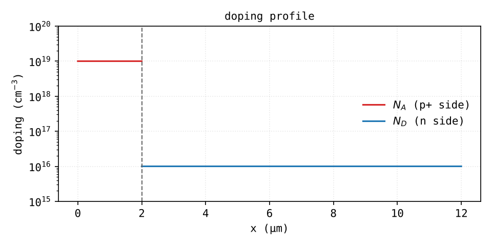

# 01 - setup + parameters

The first model is deliberately dumb: **1D abrupt p+/n junction**, two regions, uniform doping each. Everything else gets compared to this one.

## what 1D means here

Not a wire. It's a diode that's very wide in y and z, so nothing changes in those directions and you only solve along x. Units stay per volume (doping in m⁻³, charge in C/m³), and current comes out as a **density** (A/m²). Multiply by the area if you want amps.

## why p+/n and not something symmetric

- real diodes are asymmetric anyway, and the one-sided junction is the textbook case with the simplest formulas
- the depletion region sits almost entirely on the n side, so breakdown and capacitance depend on ND only
- with 1e19 on the p+ side, Auger and bandgap narrowing will actually show up later (phase A4). With 1e16 on both sides there'd be nothing to see

I'm skipping the epi layer and n+ substrate for now. They matter for series resistance and punch-through, not for the junction physics. Phase D.

## geometry



Two `Interval` nodes in COMSOL: `0 → Lp_reg` and `Lp_reg → L_tot`. After *Form Union* you get:

| entity | where | role |
|---|---|---|
| domain 1 | 0 - 2 µm | p+ |
| domain 2 | 2 - 12 µm | n |
| point 1 | x = 0 | anode |
| point 2 | x = 2 µm | junction (interior boundary) |
| point 3 | x = 12 µm | cathode |

!!! note
    Point numbering after Form Union is by x coordinate, not by the order you created them. I had labeled my geometry nodes `Interface`, `Anode`, `Catode` and they ended up as pt1/pt2/pt3 in a different order. Always click the points in the Graphics window when you select them.

Why 10 µm on the n side: at breakdown (~50-60 V) the depletion region reaches ~2.7 µm into the n side. It needs to fit with some margin, otherwise you simulate punch-through by accident.

## parameters

*Global Definitions → Parameters*. Everything goes here, no magic numbers inside the physics nodes.

```text
T0       300[K]                  temperature
Vt       k_B_const*T0/e_const    thermal voltage, ~25.85 mV
NA       1e19[1/cm^3]            p+ doping
ND       1e16[1/cm^3]            n doping
ni       9.65e9[1/cm^3]          intrinsic conc. Si @300K
Lp_reg   2[um]                   p+ length
Ln_reg   10[um]                  n length
L_tot    Lp_reg+Ln_reg
A_d      1e-4[cm^2]              area, 100x100 um
eps_s    11.7*epsilon0_const     Si permittivity
mun      1400[cm^2/(V*s)]        electron mobility (constant for now)
mup      470[cm^2/(V*s)]         hole mobility (constant for now)
tau_n    1[us]                   lifetimes
tau_p    1[us]
V0       0[V]                    anode voltage (swept later)
```

On `ni`: I'm using the newer 9.65e9 cm⁻³, not the 1.5e10 from older books. It matters more than it looks: J0 goes like ni², so the old value gives a 2.4x higher saturation current.

I first had `Vt` as a variable instead of a parameter. Moved it to Parameters because it's a constant and it's needed in boundary conditions too (and later in a temperature sweep).

## variables

*Component 1 → Definitions → Variables*. The selection of each Variables node decides **where the variable exists**. This bit me twice, see [mesh + solver](04-mesh-solver.md#errors-i-hit).

Doping, one node per domain so the step lands exactly on the junction point (no `if()`, no mesh issues):

```text
Variables 1   [domain 1]   Ndop = -NA
Variables 2   [domain 2]   Ndop =  ND
```

Everything else, on **Entire model**:

```text
Variables 3   [entire model]
n      ni*exp((psi-phin)/Vt)
p      ni*exp((phip-psi)/Vt)
R      (n*p-ni^2)/(tau_p*(n+ni)+tau_n*(p+ni))
Jn     -e_const*mun*n*phinx
Jp     -e_const*mup*p*phipx
J      Jn+Jp
I_tot  J*A_d
```

What these mean is on the [equations](02-equations.md) page. `phinx`, `phipx` are COMSOL's notation for d/dx.

No materials node: all material properties are parameters.
