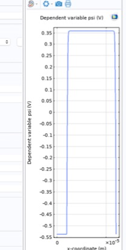

# 03 - boundary conditions

Three points: two contacts and the junction. The junction is an interior boundary, so really only two.

## ideal ohmic contact = three assumptions

1. **charge neutrality** right at the metal: p - n + Ndop = 0
2. **thermal equilibrium**: infinite recombination velocity, so np = ni² and φn = φp
3. both quasi-Fermi potentials = the metal Fermi level = applied voltage: φn = φp = V

## quasi-Fermi potentials

Straight from (3):

```text
            anode (x=0)   cathode (x=L_tot)
phin        V0            0
phip        V0            0
```

## potential: where the contact value comes from

With φn = φp = V, Boltzmann gives

$$
n - p = n_i\left(e^{(\psi - V)/V_T} - e^{-(\psi - V)/V_T}\right) = 2n_i \sinh\!\left(\frac{\psi - V}{V_T}\right)
$$

Neutrality says n - p = Ndop, so

$$
\psi = V + V_T\,\operatorname{asinh}\!\left(\frac{N_{dop}}{2n_i}\right)
$$

For |Ndop| ≫ ni this is just V ± Vt ln(|Ndop|/ni). I use the asinh form because it also works for low doping, and it's the same expression as the initial value.

```text
anode    psi = V0 + Vt*asinh(-NA/(2*ni))     -> -0.537 V at V0=0
cathode  psi =      Vt*asinh( ND/(2*ni))     -> +0.358 V
```

Reference: ψ = 0 where the intrinsic level lines up with the grounded contact's Fermi level.

## Vbi is already in the BCs

At V0 = 0:

$$
\psi_{cathode} - \psi_{anode} \approx V_T\left[\ln\frac{N_D}{n_i} + \ln\frac{N_A}{n_i}\right] = V_T\ln\frac{N_A N_D}{n_i^2} = V_{bi} \approx 0.895\ \text{V}
$$

So the solver doesn't "find" Vbi. It finds *how* ψ gets from one value to the other, i.e. the shape of the depletion region. Took me a while to realize this.

## junction: nothing

Point 2 sits between two domains that solve the same equations. COMSOL enforces continuity of the variable and of the flux there by itself: ψ and E continuous (no surface charge), φn, φp, Jn, Jp continuous. That's exactly the physics. The only thing that changes across the junction is the doping, and that's already in `Ndop`.

## what's in the model tree

Each interface: right click → *Dirichlet Boundary Condition*, twice.

| interface | point 1 (anode) | point 3 (cathode) |
|---|---|---|
| psi | `V0+Vt*asinh(-NA/(2*ni))` | `Vt*asinh(ND/(2*ni))` |
| phin | `V0` | `0` |
| phip | `V0` | `0` |

The default *Zero Flux* stays in the tree; the Dirichlet nodes override it on the contacts.

!!! danger "mistake I made"
    My first equilibrium plot had ψ dropping back to -0.54 V at the cathode instead of staying at +0.36 V. Looked like a second junction at x = 12 µm. Cause: the cathode Dirichlet node had the anode expression. If two nodes select the same point, the lower one in the tree wins, so check both selection *and* expression.

    { width="220" }

## initial values

Newton needs a decent starting point. Best cheap guess = the local-neutrality potential:

```text
psi    Vt*asinh(Ndop/(2*ni))
phin   0
phip   0
```
