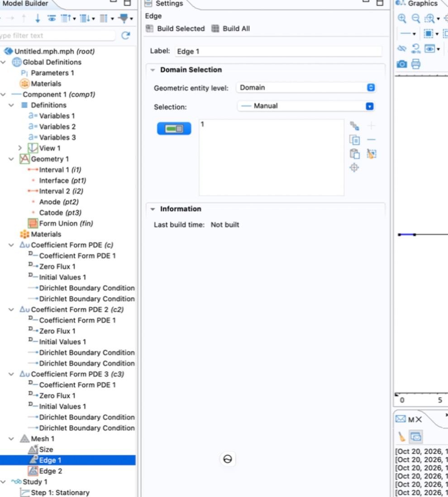

# 04 - mesh + solver

## how fine

The length scale ψ has to resolve is the Debye length:

$$
L_D = \sqrt{\frac{\varepsilon_s V_T}{q N}}
$$

~1.3 nm on the p+ side (1e19), ~41 nm on the n side (1e16). So sub-nm elements at the junction, tens of nm far away. In 1D a few thousand elements cost nothing, so don't be stingy.

## mesh nodes

*Mesh 1 → Edge*, one per domain, each with a *Distribution* child:

```text
Edge 1  [domain 1, p+]  -> Distribution 1
   predefined, geometric sequence
   elements 400, element ratio 200, reverse direction ON
Edge 2  [domain 2, n]   -> Distribution 2
   predefined, geometric sequence
   elements 600, element ratio 1000, reverse direction OFF
```

Element ratio = biggest element / smallest. The sequence grows from the start of the domain, and domain 1 runs 0 → 2 µm, so the fine end needs to be flipped to x = 2 µm. Domain 2 already starts at the junction.

Gives roughly 0.1 nm at the junction, up to ~25 nm (p+) and ~100 nm (n) near the contacts.

{ width="420" }

That's where I was when I got confused: two Edge nodes but no Distribution yet. The Edge node alone only says *where* to mesh, the Distribution says *how*. Edge 2 has the red icon because it had no selection.

Checks:

- *Mesh 1 → Statistics*: min ~0.1 nm, max ~100 nm
- zoom the Graphics window around x = 2 µm, elements should get denser from **both** sides. If one side gets denser towards the contact, flip *reverse direction* on that one
- convergence: halve the element size, I-V shouldn't move more than ~1 %  (TODO: actually do this once the I-V works)

The python reference uses the same kind of grading (`geo()` in `pn1d_reference.py`, 4001 nodes), so the two solutions are directly comparable.

## solver strategy

Three strongly coupled nonlinear equations. Throwing all three at Newton at nonzero bias = divergence. So, in steps:

| step | type | solves | initial values | sweep |
|---|---|---|---|---|
| 1 | Stationary | psi only (c2, c3 disabled) | `Vt*asinh(Ndop/(2*ni))` | - |
| 2 | Stationary | all three | solution of step 1 | aux sweep V0 = `range(0,0.01,0.8)` |

With c2 and c3 disabled in step 1, φn and φp stay at their initial value 0. That *is* equilibrium, so step 1 alone is the A1 result.

Disable an interface for one step: *Physics and Variables Selection → Modify model configuration for study step*, untick.

If step 2 doesn't converge (it probably won't the first time):

1. smaller voltage steps at the start of the sweep
2. keep continuation on (default for aux sweeps)
3. manual variable scaling ~1 V in the solver settings
4. finer mesh at the junction

## errors I hit

In order:

```text
Undefined variable.
 - Variable: comp1.Vt
 - Geometry: geom1
 - Domain: 2
```

Variables 3 was selected on **point 2** only (the junction). A variable selected on a point only exists on that point. Fix: Variables 3 → *Entire model*. Also moved `Vt` into Parameters.

```text
Undefined variable.
 - Variable: ni
 - Domain: 1
```

```text
Undefined variable.
 - Variable: eps_s
Failed to evaluate variable.
 - Variable: comp1.c.c
 - Defined as: eps_s
...
```

Just missing parameters. Lesson: when you see *Undefined variable*, only read the first line. The rest is the chain of where it's used (here: c of the Poisson interface → flux → Jacobian). The cause is basically always one of two things: not defined, or defined in a node with the wrong selection. Check the whole parameter list once instead of fixing them one by one like I did.

Third one was the wrong cathode BC, see [boundary conditions](03-boundary-conditions.md).
