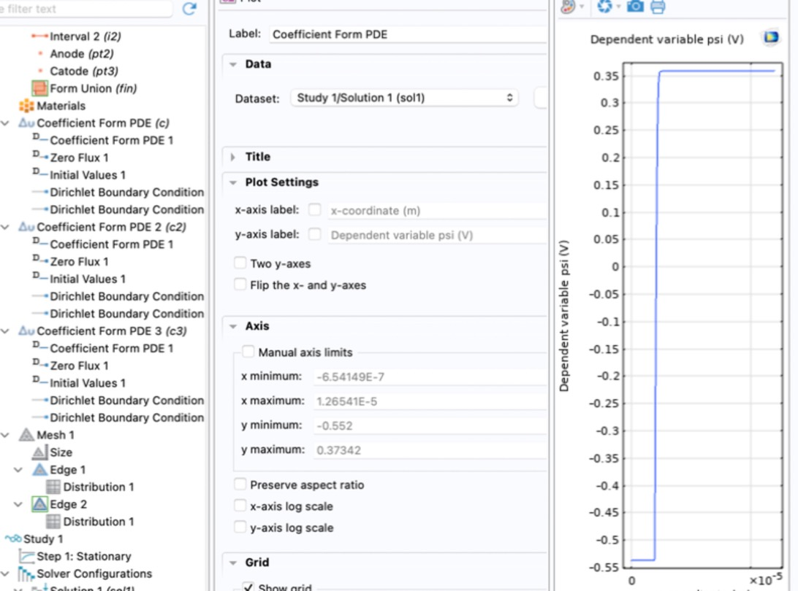
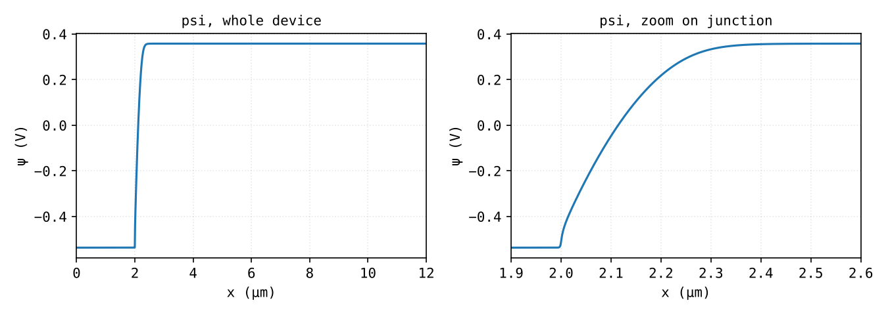
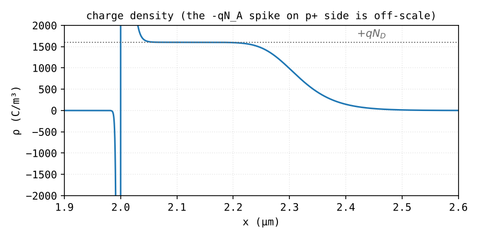
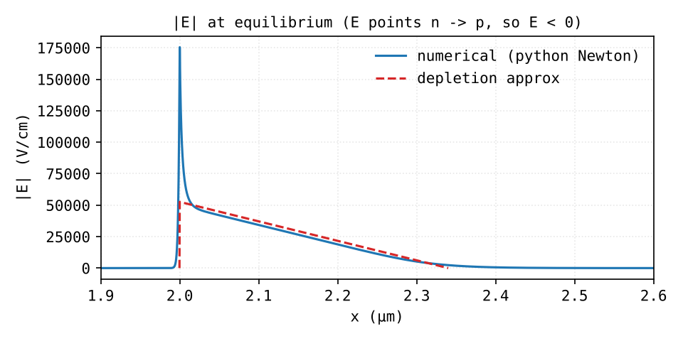
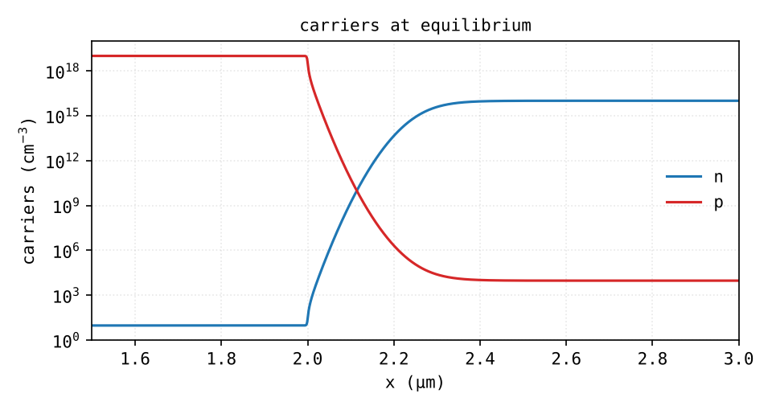
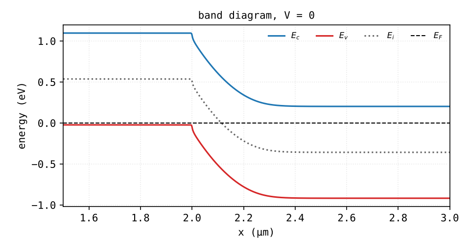
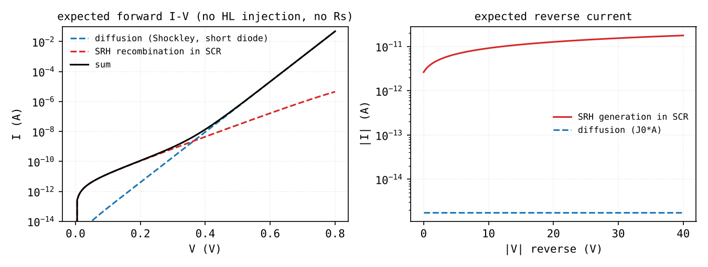

# 05 - equilibrium results (A1)

Step 1 only: Poisson, V0 = 0.

The plots below come from `analytics/pn1d_reference.py`, a ~150-line Newton solver for the same Poisson problem (same parameters, same BCs, similar mesh). I wrote it to have something independent to diff COMSOL against. COMSOL exports aren't overlaid yet: TODO, need to export the line plots to `data/comsol/` as CSV.

## numbers

| quantity | formula | analytic | python | COMSOL |
|---|---|---|---|---|
| ψ, p+ side | -Vt ln(NA/ni) | -0.537 V | -0.537 V | ~-0.54 V |
| ψ, n side | Vt ln(ND/ni) | +0.358 V | +0.358 V | ~+0.36 V |
| Vbi | Vt ln(NA·ND/ni²) | 0.895 V | 0.895 V | ~0.89 V |
| W @ 0 V | √(2ε Vbi/(q ND)) | 0.340 µm (0.330 with -2Vt) | 0.31-0.32 µm | todo |
| xp @ 0 V | W·ND/(NA+ND) | 0.34 nm | - | - |
| Emax @ 0 V | 2Vbi/W | 5.3e4 V/cm | see below | todo |

"Python W" = where n drops below ND/2 on the n side. The depletion approximation assumes a sharp edge, the real edge is smeared over ~one n-side Debye length (41 nm), so a slightly smaller number is expected.

## COMSOL, first run

{ width="560" }

Looks like a step because the depletion region is < 3 % of the 12 µm. Need to zoom to see anything (Axis → Manual axis limits, x from 1.9e-6 to 2.6e-6).

## potential



Zoomed in it's the parabola you'd expect, almost entirely on the n side.

## charge density



Charge density on the n side is the rectangle at +q·ND ≈ +1.6e3 C/m³, about 0.3 µm wide, with a soft edge at ~2.3 µm. On the p+ side there's a spike at -q·NA ≈ -1.6e6 C/m³, a thousand times taller but under a nm wide, so it's off the scale. Same area on both sides (global neutrality). This is the one-sided junction picture, but for real.

There's also a small positive bump right after x = 2 µm, above q·ND. Those are holes from the p+ side spilling a few nm into the n side. More on that in the field plot.

In COMSOL: `e_const*(p-n+Ndop)`, y-axis manually clipped to ±2000. With auto-scaling you only see the p+ spike and the rectangle looks like zero.

## electric field



Sign first: the field points from n to p, i.e. towards -x, so `-psix` in COMSOL gives negative values. The plot shows |E|.

Away from the junction the numerical field follows the depletion-approx triangle pretty well (a bit lower, consistent with the smaller W). But in the first ~10 nm on the n side there's a narrow spike up to ~1.75e5 V/cm, about 3x the textbook Emax.

This had me thinking I'd broken something (and I *had*, at first: a bug in my script put half-doping on every node within 10 nm of the junction because `np.isclose` has an absolute tolerance of 1e-8, which is 10 nm in meters. Fixed). After the fix the spike is still there, and it's real: with an abrupt step and NA/ND = 1000, holes from the p+ side diffuse a few p+ Debye lengths (~1.3 nm) into the n side. That makes a very thin dipole right at the junction, and the field peaks there. The depletion approximation can't see it because it assumes the carrier concentrations drop to zero instantly.

COMSOL should show the same spike. It's an artifact of the *abrupt* profile: with a graded profile (phase D) it should go away. Worth checking.

## carriers



What to read off the log plot:

- p+ side: p ≈ 1e19, n ≈ ni²/NA ≈ 9 cm⁻³
- n side: n ≈ 1e16, p ≈ ni²/ND ≈ 9e3 cm⁻³
- depletion region: both way below the doping. n = p = ni where the curves cross, on the n side

## band diagram



Ei = -qψ (referenced to the Fermi level), Ec/Ev = Ei ± Eg/2, which is only approximately right (Ei isn't exactly midgap) but fine here. Flat Fermi level, bands bend by q·Vbi ≈ 0.89 eV.

In COMSOL: `-psi+0.56`, `-psi-0.56`, `-psi`, plotted as eV.

## next: current (A2/A3)

Step 2 with the voltage sweep. What I expect:



```text
hole diffusion length Lp      ~33 um  > n region (9.7 um neutral) -> short diode
J0                            ~1.8e-11 A/cm^2   I0 ~ 1.8e-15 A
n=2 -> n=1 crossover          ~0.35-0.4 V
reverse current @ -10 V       ~9e-8 A/cm^2 (~9 pA), SRH generation dominates by ~5000x
```

No high injection and no series resistance in these curves, so above ~0.7 V the simulation should start deviating. That's one of the things I want to see.

!!! note
    For J0 I used doping-dependent mobility (430 cm²/Vs for holes on the n side). COMSOL still has constant 470, so expect its J0 ~5 % higher. Not a bug.
